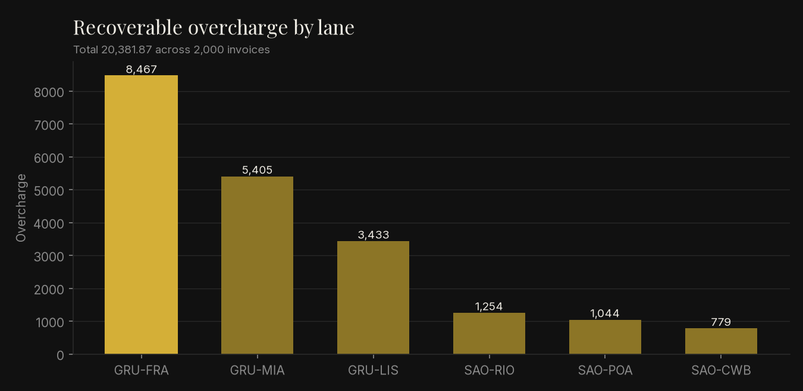
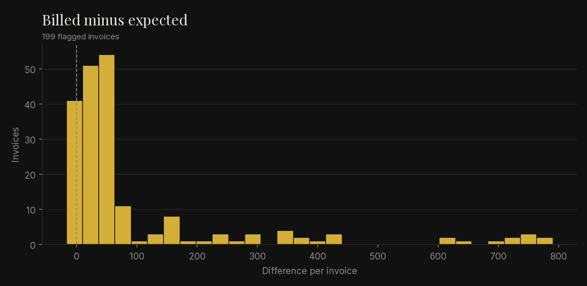

# freight-audit

Recomputes what each freight invoice should have cost under the contract and
lists the ones that don't match.

## Problem

A carrier invoice line depends on several rules at once: volumetric weight,
weight breaks, a minimum charge and a fuel surcharge. One wrong divisor or an
old rate is hard to spot reading line by line, but it adds up over a few
thousand shipments.

## Method

For each invoice line:

1. Chargeable weight = max(actual kg, L·W·H / divisor), rounded up to 0.5 kg.
2. Rate = the highest weight break reached; that rate prices the whole weight.
3. Freight = max(weight × rate, minimum charge).
4. Fuel = freight × fuel % / 100, after the minimum.
5. Compare with the billed freight and fuel; anything over 0.01 is flagged.

Money uses `Decimal`, rounded half-up to cents. Why the divisor exists and how it
relates to vehicle payload and volume: [docs/derivation.md](docs/derivation.md).

## How to run

```bash
python -m venv .venv && . .venv/bin/activate
pip install -e ".[dev]"
freight-audit generate --out data -n 2000 --seed 42
freight-audit audit --tariffs data/tariffs.csv --invoices data/invoices.csv --report discrepancies.csv
pytest                 # fails below 100% coverage
ruff check . && mypy
```

`tariffs.csv` has one row per weight break:
`lane,mode,min_kg,rate_per_kg,minimum_charge,fuel_pct,divisor`.
`invoices.csv`:
`invoice_id,lane,mode,actual_kg,length_cm,width_cm,height_cm,billed_freight,billed_fuel`.

Figures in `docs/img/` are redrawn with `pip install matplotlib && PYTHONPATH=src:scripts python scripts/make_charts.py` (and `scripts/make_hero.py`).

## Result on the generated data

`generate` makes 2,000 invoices on six made-up lanes (seed 42) and puts one
billing error in about 12% of them: wrong divisor, fuel on an inflated base,
wrong weight break, or a manual surcharge. Output of the audit command above:

| | |
|---|---|
| Invoices audited | 2,000 |
| Overcharges flagged | 198 (9.90%) |
| Undercharges flagged | 1 |
| Billed total | 1,050,316.38 |
| Expected total | 1,029,951.57 |
| Recoverable overcharge | 20,381.87 |

Fewer than 12% get flagged because some injected errors change nothing, e.g. a
wrong weight break on a shipment that is already in the first break.




## Limits

- Default divisors (6000 air, 5000 express, 3000 road) are common values, not
  rules. Check the contract.
- One rate per weight break. No break-point pricing, accessorials, per-piece
  dimension rules, currency conversion or taxes.
- The error rate in the generated data is chosen to exercise the rules. It says
  nothing about real carriers.

MIT license.
