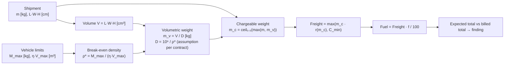
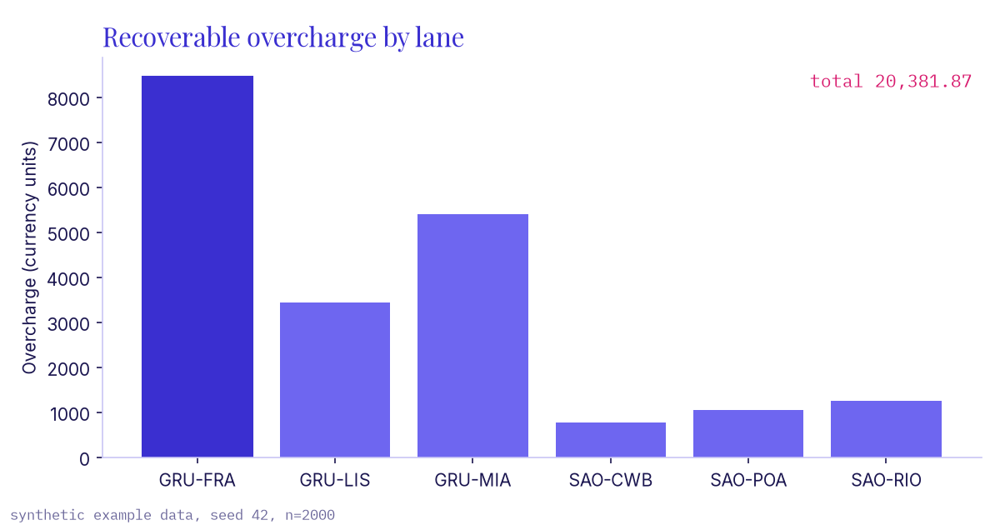
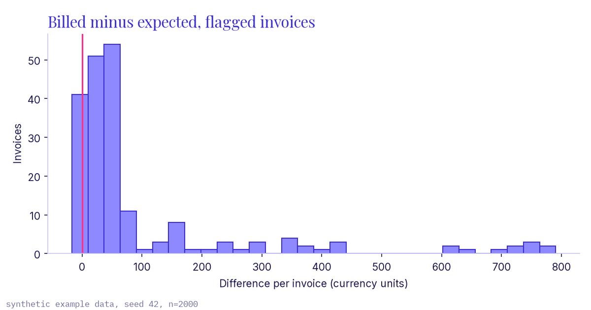

# freight-audit

Reconcile contracted freight tariffs against billed charges and flag overcharges.

## What

`freight-audit` recomputes what each shipment *should* have cost under the
contract (tariff lookup by lane and mode, chargeable weight, weight breaks,
minimum charge, fuel surcharge) and compares it with what was billed. It writes
a discrepancy report (CSV) and a summary with the recoverable amount.

## Why

Freight invoices mix several rules: volumetric weight, weight breaks, minimums
and surcharges. A single wrong divisor or an outdated rate is easy to miss on a
line-by-line read but adds up across thousands of shipments. An audit that
recomputes every line from the contract makes those errors visible.

## Physical model

Every vehicle is limited by both payload mass and usable volume. Shipments
lighter than the vehicle's break-even density fill space before mass, so they
are charged on volumetric weight. Full derivation, units and a hand-computed
validation: [docs/derivation.md](docs/derivation.md).



## How to run

```bash
python -m venv .venv && . .venv/bin/activate
pip install -e ".[dev]"
freight-audit generate --out data -n 2000 --seed 42
freight-audit audit --tariffs data/tariffs.csv --invoices data/invoices.csv --report discrepancies.csv
pytest            # tests with 100% coverage gate
ruff check . && mypy
pip install matplotlib && PYTHONPATH=src python scripts/make_charts.py   # refresh docs/*.png
```

Input formats: `tariffs.csv` is long format, one row per weight break
(`lane,mode,min_kg,rate_per_kg,minimum_charge,fuel_pct,divisor`);
`invoices.csv` has `invoice_id,lane,mode,actual_kg,length_cm,width_cm,height_cm,billed_freight,billed_fuel`.

## Results (synthetic example data)

All figures below come from the seeded synthetic dataset (`seed=42`,
2,000 invoices, about 12% with one injected billing error: wrong divisor, fuel
on an inflated base, wrong weight break, or a manual surcharge). They do not
describe any real carrier or company.

| Metric (synthetic example data) | Value |
|---|---|
| Invoices audited | 2,000 |
| Overcharges flagged | 198 (9.90%) |
| Undercharges flagged | 1 |
| Billed total | 1,050,316.38 |
| Expected total | 1,029,951.57 |
| Recoverable overcharge | **20,381.87** |

Some injected errors have no effect (for example a wrong weight break on a
shipment that already sits in the first break), so fewer than 12% are flagged.




## Limits and honest scope

- Divisors (6000 air, 5000 express, 3000 road) are configurable assumptions;
  real contracts vary by carrier and market.
- Single-rate weight breaks only; no break-point pricing, accessorials,
  dimensional rules per piece, currency conversion or taxes.
- The synthetic dataset is designed to exercise the rules, not to reflect real
  error rates. Recovery amounts on real invoices will differ.

## License

MIT, see [LICENSE](LICENSE).
